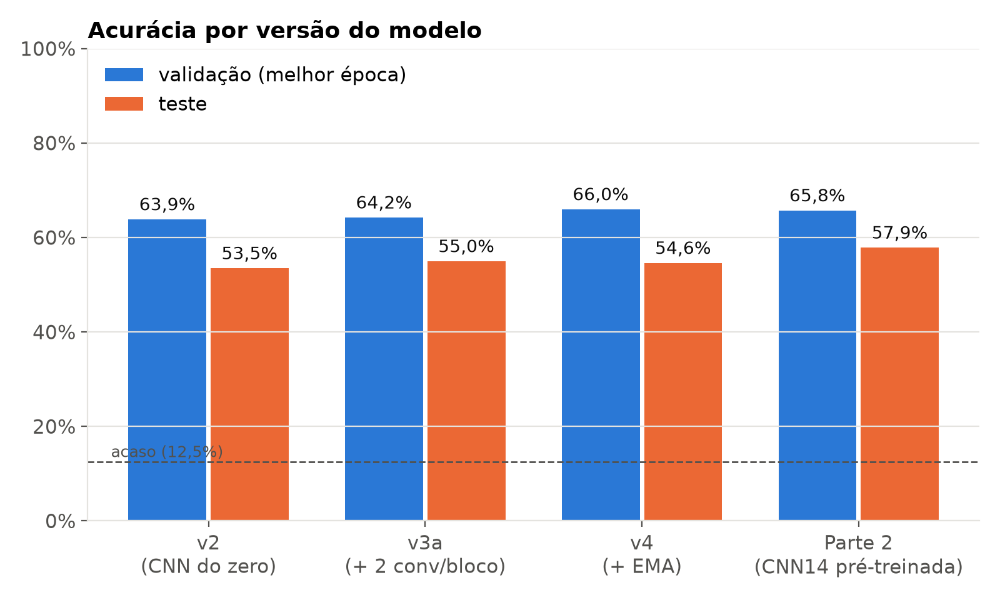
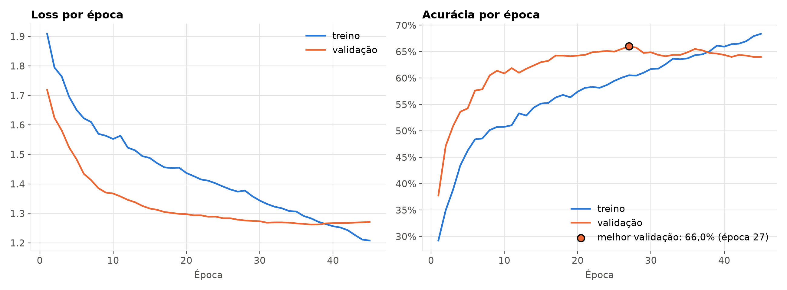
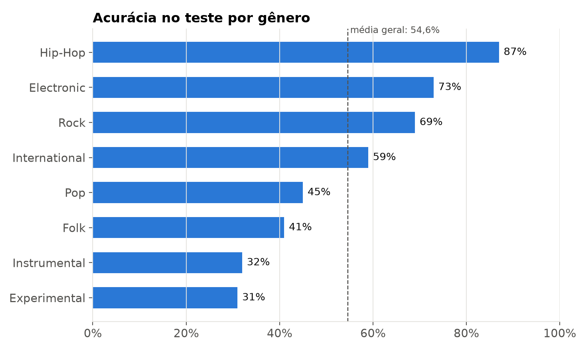
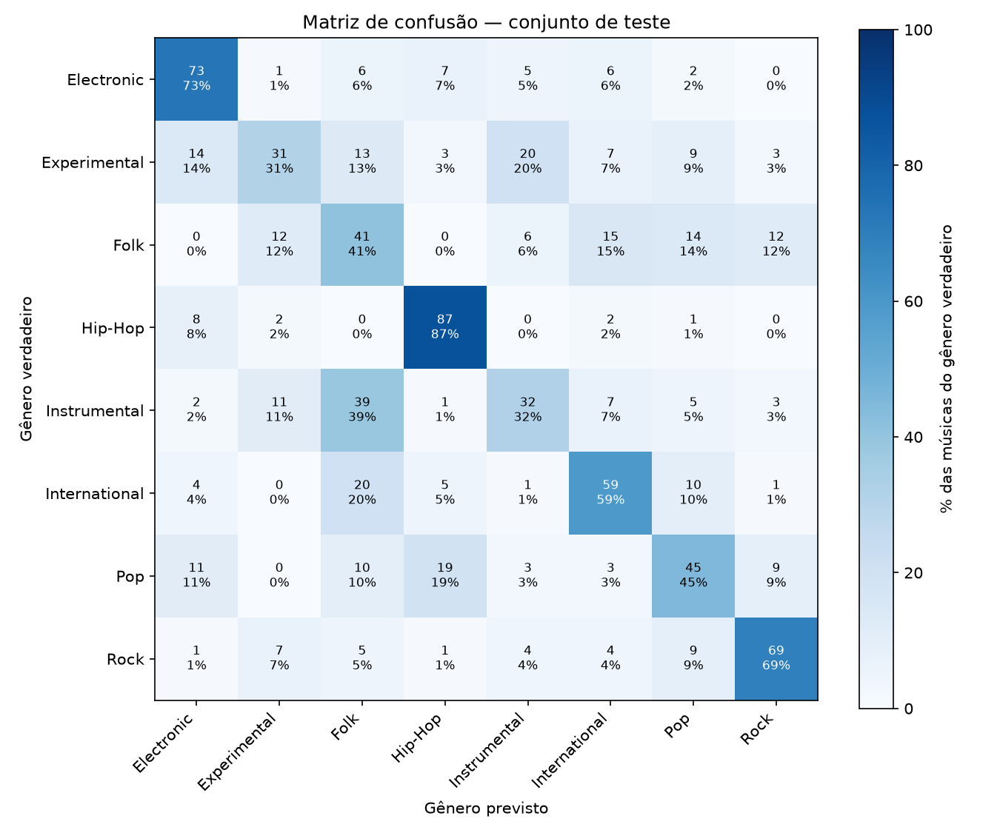

# Classificação de Gêneros Musicais com CNN

Projeto da disciplina de Deep Learning (trilha Áudio & Linguagem).
Uma CNN em PyTorch recebe o **Mel Spectrogram** de uma música e classifica em um dos
**8 gêneros** do dataset [FMA Small](https://github.com/mdeff/fma):
Electronic, Experimental, Folk, Hip-Hop, Instrumental, International, Pop e Rock.

O projeto tem duas partes:
- **Parte 1 — CNN treinada do zero** (o foco do projeto): quatro versões, cada mudança testada separadamente.
- **Parte 2 — Transfer learning**: a mesma tarefa usando a CNN14 do [PANNs](https://github.com/qiuqiangkong/audioset_tagging_cnn),
  pré-treinada em ~2 milhões de áudios, para comparar os dois caminhos.

| | Validação | **Teste** |
|---|---|---|
| Parte 1: CNN do zero (v4) | 66,0% | **54,6%** |
| Parte 2: CNN14 pré-treinada + classificador | 65,8% | **57,9%** |
| Chute aleatório (8 gêneros) | 12,5% | 12,5% |

> O conjunto de teste (800 músicas) foi usado **uma única vez** por modelo, no final.
> Todas as escolhas (arquitetura, hiperparâmetros, época) foram feitas pela validação.



## Demonstração: classifique qualquer música

```bash
python predict.py minha_musica.mp3
```

Saída real para duas músicas do conjunto de teste (gêneros verdadeiros: International e Electronic):

```
000709.mp3  (30s, 1 trecho(s) de 30s)
  1. International   93.3%  ############################
  2. Pop              2.6%  #
  3. Experimental     1.0%

013711.mp3  (30s, 1 trecho(s) de 30s)
  1. Electronic      68.0%  ####################
  2. Pop              6.6%  ##
  3. Experimental     6.6%  ##
```

O modelo treinado (`modelo_v4.pt`, ~10 MB) fica na página de
[Releases](https://github.com/rickyz-120/projeto_music/releases): baixe e coloque na pasta do projeto.
Ele é um "pacote" com os pesos, a arquitetura, os gêneros e a normalização, então o
`predict.py` funciona sem o dataset. A música é dividida em trechos de 30s e as
probabilidades de cada trecho são combinadas por média.

## Parte 1 — CNN do zero

**Entrada:** Mel Spectrogram `(1, 128, 1292)` (128 faixas de frequência × 30s), em dB e normalizado por faixa de frequência.
**Arquitetura (`model.py`):** 5 blocos de (Conv 3×3 + BatchNorm + ReLU) ×2 + MaxPool, com 32→64→128→256→256 filtros,
pooling global (média + máximo) e um classificador 512→256→8 com dropout. ~2,5 M parâmetros.
**Treino (`train.py`):** trechos aleatórios de 10s + SpecAugment, AdamW, label smoothing, learning rate em cosseno,
mixed precision (cabe em 4 GB de VRAM), média móvel dos pesos (EMA), checkpoints a cada época.



### Evolução das versões

| Versão | O que mudou | Validação | Teste |
|---|---|---|---|
| v1 | 4 blocos conv, áudio decodificado a cada época | — | — |
| v2 | espectrogramas pré-calculados, 5 blocos, SpecAugment, pooling global | 63,9% | 53,5% |
| v3a | 2 convoluções por bloco, mixup, learning rate em cosseno | 64,3% | 55,0% |
| v4 | EMA dos pesos, sem mixup | **66,0%** | 54,6% |

Experimentos da v4 (todos comparados na validação):

| Experimento | Melhor val | Média das últimas 10 épocas |
|---|---|---|
| v3a (referência) | 64,25% | 62,3% |
| + EMA dos pesos (`--ema 0.999`) | 65,5% | 64,2% |
| + EMA + trecho de 15s (`--crop 646`) | 64,25% | 63,7% |
| **+ EMA, sem mixup (`--mixup 0`)** → v4 | **66,0%** | **64,5%** |
| v4 com 30 épocas | 64,0% | — |
| v4 + conexões residuais (`--residual`) | 65,5% | 64,4% |

A EMA reduziu a oscilação da validação de ±1,6% para ±0,3% por época, o que deixou a escolha do
melhor modelo muito mais confiável. No teste, porém, a v4 empatou com a v3a (diferença dentro da margem de
±1,8% de um teste com 800 músicas).

### Onde o modelo acerta e erra




## Parte 2 — Transfer learning

Em vez de aprender tudo com 6.400 músicas, usamos a **CNN14**, uma CNN treinada no AudioSet
(~2 milhões de áudios do YouTube, 527 tipos de som). Ela fica **congelada**: cada música vira um vetor
de 2048 números (o *embedding*), extraído uma única vez (`panns_features.py`). Depois, só um classificador
pequeno é treinado em cima disso (`train_transfer.py`), no mesmo formato do classificador da Parte 1.

| Gênero | CNN do zero (v4) | CNN14 pré-treinada |
|---|---|---|
| Electronic | 73% | 79% |
| Experimental | 31% | 48% |
| Folk | 41% | 38% |
| Hip-Hop | 87% | 86% |
| Instrumental | 32% | 33% |
| International | 59% | 68% |
| Pop | 45% | 39% |
| Rock | 69% | 72% |
| **Geral (teste)** | **54,6%** | **57,9%** |

Na validação os dois empataram (66,0% × 65,8%), mas no teste o modelo pré-treinado foi 3,3 pontos melhor:
como ele aprendeu com uma variedade enorme de áudios, **generaliza melhor** para músicas novas.

## Conclusões e limitações

- **Os gêneros difíceis são difíceis por natureza.** Experimental, Instrumental, Folk e Pop se sobrepõem:
  39% das músicas *Instrumental* foram classificadas como *Folk*, porque muitas são de violão ou piano acústico,
  o mesmo timbre do Folk. Já *Hip-Hop* e *Electronic*, com batidas e timbres característicos, passam de 70%.
- **Parte dos erros não é "culpa" do modelo.** Na validação, a CNN do zero e a CNN14 (que aprenderam de
  formas completamente diferentes) **erram juntas em 26% das músicas**. Isso aponta para faixas ambíguas
  ou com rótulo discutível, e não só para falta de capacidade do modelo.
- **Validação e teste se comportam diferente.** Todas as versões perderam ~10 pontos da validação para o teste.
  Com 800 músicas por conjunto, diferenças de 1–2 pontos estão dentro do ruído.
- **Mais regularização nem sempre ajuda.** Com EMA, SpecAugment e label smoothing, o mixup passou a atrapalhar.
- **Limitações:** um único dataset (FMA Small, 8 gêneros equilibrados), cada música com um único gênero,
  e apenas trechos de 30s.
- **Próximos passos:** fazer *fine-tuning* da CNN14 (descongelar as últimas camadas), testar outros modelos
  pré-treinados de áudio e usar o FMA Medium (16 gêneros, ~25 mil músicas).

## Estrutura

| Arquivo | O que faz |
|---|---|
| `preprocess.py` | Calcula os Mel Spectrograms uma única vez e salva em `data_mels/` |
| `dataset.py` | Lê os espectrogramas, normaliza e aplica data augmentation (recorte + SpecAugment) |
| `model.py` | Arquitetura da CNN (`GenreCNN`) + sanity check (`python model.py`) |
| `train.py` | Treino da Parte 1 |
| `evaluate.py` | Avaliação no teste ou na validação (`--split`), de um modelo ou ensemble |
| `predict.py` | Classifica qualquer arquivo de áudio com o modelo treinado |
| `gerar_figuras.py` | Gera as figuras deste README |
| `panns_cnn14.py` | (Parte 2) Arquitetura da CNN14 do PANNs (licença MIT, Kong et al.) |
| `panns_features.py` | (Parte 2) Extrai os embeddings da CNN14 uma única vez |
| `train_transfer.py` | (Parte 2) Treina o classificador sobre os embeddings |
| `versoes_antigas/` | Código das versões v1 e v2, guardado para comparação |

## Como reproduzir

1. Baixe e extraia o dataset (não está no repositório por ser muito pesado):
   - [`fma_small.zip`](https://os.unil.cloud.switch.ch/fma/fma_small.zip) (~7,2 GB) → pasta `fma_small/`
   - [`fma_metadata.zip`](https://os.unil.cloud.switch.ch/fma/fma_metadata.zip) → pasta `fma_metadata/` (precisa do `tracks.csv`)
2. Instale as dependências: `pip install -r requirements.txt`
   (PyTorch com GPU: `pip install torch torchvision torchaudio --index-url https://download.pytorch.org/whl/cu121`)
3. Rode a partir da pasta do projeto:

```bash
# Parte 1
python preprocess.py        # uma vez só (~20-30 min)
python train.py             # treino (~30 min numa RTX 3050 de 4 GB)
python evaluate.py          # avaliação no teste

# Parte 2 (precisa dos pesos pretrained/Cnn14_mAP=0.431.pth: https://zenodo.org/record/3987831)
python panns_features.py    # uma vez só (~20 min)
python train_transfer.py    # treino do classificador (segundos); --test para a avaliação final
```
